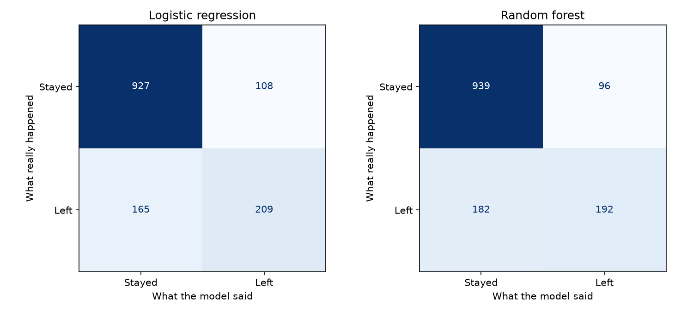
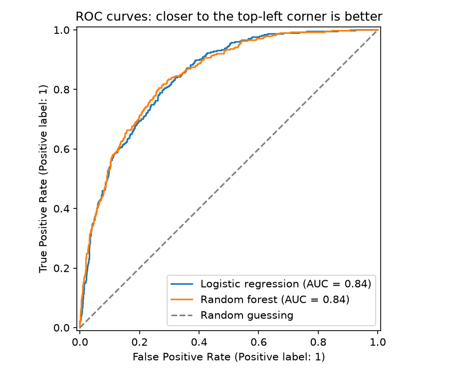
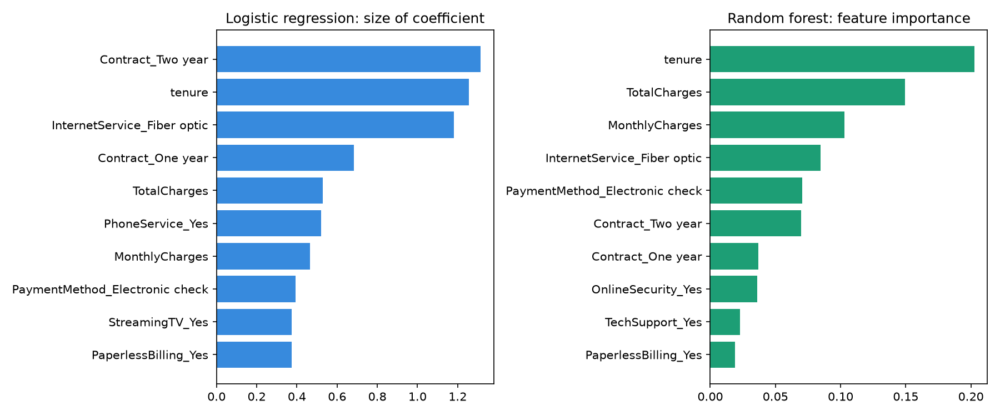

# Customer Churn Prediction

An end-to-end machine learning project that predicts which customers of a telecom company are likely to leave (churn), and compares two classification models: **logistic regression** and **random forest**.

## Project goal

Losing customers is expensive. If a company can spot customers who are likely to leave, it can contact them early, for example with a better contract offer. This project builds and compares two models that predict churn from customer data, and explains which one is more useful for the business.

## Dataset

[IBM Telco Customer Churn](https://github.com/IBM/telco-customer-churn-on-icp4d), a public dataset of **7,043 customers** with 21 columns:

- **Account:** tenure (months), contract type, payment method, paperless billing
- **Charges:** monthly and total charges
- **Services:** phone, internet type, online security, tech support, streaming
- **Customer:** gender, senior citizen, partner, dependents
- **Target:** `Churn` (Yes/No). 26.5% of customers left.

## Steps

1. **Exploration** (`src/explore_data.py`): checked data types, found 11 hidden missing values, and charted churn by contract, tenure and monthly charges.
2. **Data processing** (`src/data_processing.py`):
   - Filled the 11 missing `TotalCharges` with 0 (all were brand-new customers with no bill yet)
   - Removed `customerID`
   - One-hot encoded 15 text columns
   - Split the data 80/20 into training and test sets, keeping the same churn rate in both
   - Scaled the number columns, fitting the scaler on the training data only to avoid data leakage
3. **Training** (`src/train_models.py`): trained logistic regression and a random forest (300 trees, `min_samples_leaf=10`).
4. **Evaluation** (`src/evaluate.py`): compared both models with a lazy baseline on 1,409 unseen test customers.

The math behind both models is explained in [`docs/math_background.md`](docs/math_background.md).

## Results

| Model | Accuracy | Precision | Recall | F1 score | ROC AUC |
|---|---|---|---|---|---|
| Baseline (always "stay") | 0.735 | 0.000 | 0.000 | 0.000 | 0.500 |
| **Logistic regression** | **0.806** | 0.659 | **0.559** | **0.605** | 0.842 |
| Random forest | 0.803 | **0.667** | 0.513 | 0.580 | **0.845** |

**Chosen model: logistic regression.**

- Both models rank customers almost equally well (ROC AUC 0.842 vs 0.845).
- Logistic regression finds more of the customers who actually leave (recall 55.9% vs 51.3%), which matters most for churn, because a missed leaver usually costs more than a false alarm.
- Its coefficients are easy to explain to the business. For example, a two-year contract lowers the odds of leaving by about 73%.
- The random forest didn't win, because the main churn drivers are simple, one-by-one patterns that a linear model already captures.

**Main churn drivers:** short tenure, month-to-month contracts, fibre optic internet, and paying by electronic check.





**Limitation and next step:** at the default 50% threshold, both models find only about half of the leavers. Lowering the threshold would find more of them, at the cost of more false alarms. The right threshold depends on the cost of a retention offer compared with the value of a saved customer.

## Project structure

```
ml-learning-project/
├── data/
│   ├── raw/                 # original dataset (downloaded, not changed)
│   └── processed/           # cleaned train/test files (created by the pipeline)
├── docs/
│   └── math_background.md   # how both models work, with formulas
├── models/                  # saved trained models (created by the pipeline)
├── results/                 # charts and comparison table
├── src/
│   ├── explore_data.py      # exploratory data analysis
│   ├── data_processing.py   # cleaning, encoding, splitting, scaling
│   ├── train_models.py      # trains and saves both models
│   ├── evaluate.py          # metrics, comparison table, charts
│   └── main.py              # runs the full pipeline
└── requirements.txt
```

## How to run

Requires Python 3.10 or newer. Run these commands from the project folder.

```bash
# 1. Create and activate a virtual environment
python -m venv .venv
source .venv/bin/activate        # Windows: .venv\Scripts\activate

# 2. Install the libraries
pip install -r requirements.txt

# 3. (Optional) Explore the data
python src/explore_data.py

# 4. Run the full pipeline
python src/main.py
```

The dataset is already included in `data/raw/telco_churn.csv`.

The results appear in the terminal and in the `results/` folder.

## Tools

Python, pandas, scikit-learn, matplotlib